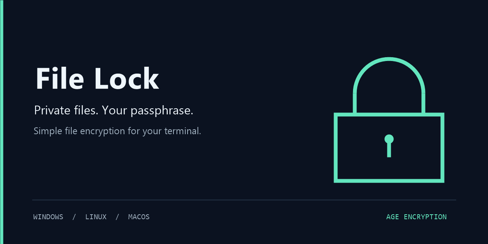

<p align="center">
  
</p>

<p align="center">
  <a href="https://github.com/Majkey25/File-Lock/releases/latest"></a>
  <a href="https://github.com/Majkey25/File-Lock/actions/workflows/ci.yml"></a>
  <a href="LICENSE"></a>
  <a href="https://age-encryption.org"></a>
</p>

# File Lock

A small, offline terminal app for encrypting individual files with a passphrase. Choose a file once, then lock or unlock it from a simple menu. Encrypted files remain movable, renameable and deletable.

No account, cloud service or runtime installation. Available for Windows, Linux and macOS.

## Download

Choose the archive for your system. Each download includes the executable, documentation and dependency licenses.

| System | Download |
| :--- | :--- |
| Windows | [Download x64 ZIP](https://github.com/Majkey25/File-Lock/releases/latest/download/File-Lock-windows-x64.zip) |
| Linux | [Download x64](https://github.com/Majkey25/File-Lock/releases/latest/download/File-Lock-linux-x64.tar.gz) · [Download ARM64](https://github.com/Majkey25/File-Lock/releases/latest/download/File-Lock-linux-arm64.tar.gz) |
| macOS | [Download Apple Silicon](https://github.com/Majkey25/File-Lock/releases/latest/download/File-Lock-macos-arm64.tar.gz) · [Download Intel](https://github.com/Majkey25/File-Lock/releases/latest/download/File-Lock-macos-x64.tar.gz) |

[All releases](https://github.com/Majkey25/File-Lock/releases) · [SHA-256 checksums](https://github.com/Majkey25/File-Lock/releases/latest/download/SHA256SUMS.txt)

## Get started

**Windows:** extract the ZIP completely, then open `File-Lock.cmd` or run `FileLock.exe` in your terminal.

**Linux and macOS:** extract the archive, open its folder in Terminal, then run:

```sh
./file-lock
```

```text
  [0] Setup    [1] Lock    [2] Unlock    [Q] Quit
```

1. Enter `0` and paste the full path to a file you own.
2. Enter `1`, choose a passphrase and confirm it. Use at least 12 characters; five or more randomly chosen words are a better choice.
3. Enter `2` and provide the same passphrase to restore the file. Each menu choice requires Enter.

Locking `notes.txt` creates `notes.txt.age`. Unlocking restores `notes.txt`. The app verifies the completed output before removing its source and refuses to overwrite existing files. If a locked file moves, keep the `.age` extension and select its new path with `0`.

**Keep your passphrase and an independent backup. There is no password reset, backdoor or recovery key.**

## How protection works

File Lock uses the maintained [age library](https://github.com/FiloSottile/age) and its standard encrypted file format. Passphrase protection uses scrypt with work factor 18 and authenticated ChaCha20-Poly1305 encryption. Passphrases stay out of settings and command-line arguments.

* Encryption is verified by decrypting the new copy and comparing its SHA-256 with the source.
* Decryption must authenticate the entire file before restored plaintext becomes available at the destination.
* Private staging and atomic no-overwrite publishing protect against partial outputs and destination conflicts.
* Windows uses mandatory sharing locks. Linux and macOS use advisory locks, source-change checks and source quarantine during removal. Close editors and other programs using the file before processing it.

Supported inputs are regular local files. Windows requires a fixed NTFS volume. Links, directories, special files and metadata the app cannot preserve are refused. On Linux and macOS, use a trusted folder you own. Files with extended attributes, including macOS resource forks, are refused.

Encryption does not hide filenames or erase old disk contents, backups or cloud history. Builds are unsigned and macOS builds are not notarized. OS download protections may require your review before execution. See [security and recovery](docs/security.md) for the full limits, recovery commands and interrupted-operation guidance.

## Build and verify

Install Go 1.27.3 or newer. No C compiler is required.

```sh
go mod verify
go vet ./...
go test -count=1 ./...
go run golang.org/x/vuln/cmd/govulncheck@v1.9.0 ./...
go build -trimpath -o file-lock .
```

On Windows, use `-o FileLock.exe`. Release packaging uses `pwsh -NoProfile -File scripts/build.ps1` on the target system. CI runs native tests and builds on Windows x64, Linux x64/ARM64 and macOS Intel/Apple Silicon before publishing release archives.

## License

[MIT](LICENSE). Third-party license notices ship with every release.
